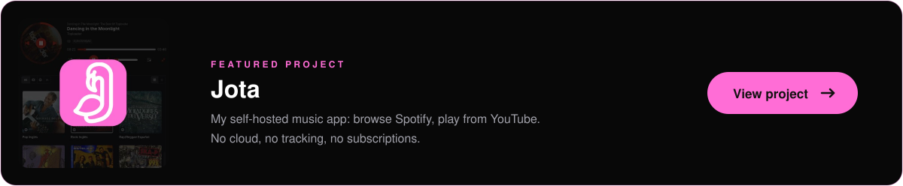
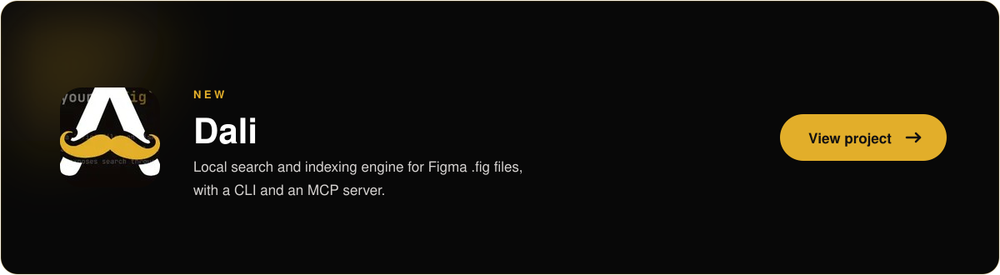
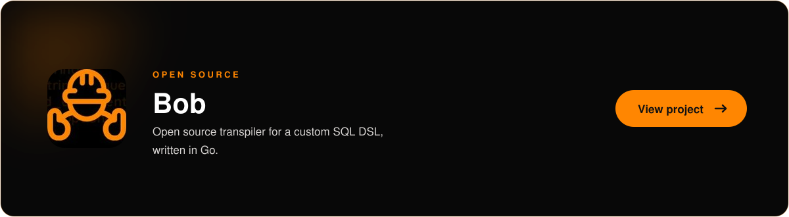

  

  
  

I write poetry, I write code, 
and I sing in <a href="https://github.com/Jota-Music">Jota</a>.

 

## Featured

<table>
  <tr>
    <td width="33%" align="center" valign="top">
      
    </td>
    <td width="33%" align="center" valign="top">
      
    </td>
    <td width="33%" align="center" valign="top">
      
    </td>
  </tr>
</table>

## Also open source

- [**searchable-select**](https://github.com/salvadorsru/searchable-select) — searchable dropdown web component, dependency-free.
- [**card-deck**](https://github.com/salvadorsru/card-deck) — swipeable card stack as a web component.
- [**simple-pot-generator-cli**](https://github.com/salvadorsru/simple-pot-generator-cli) — generates `.pot` i18n files.
- [**touch-command-in-rust**](https://github.com/salvadorsru/touch-command-in-rust) — the Unix `touch` command, built in Rust.

## Organizations

- [**Jota-Music**](https://github.com/Jota-Music) — self-hosted music streaming: client, relay and web.
- [**Bob-Object-Builder**](https://github.com/Bob-Object-Builder) — a custom SQL DSL and its tooling.

  Go · TypeScript · JavaScript · Rust · Astro · Web Components

---

  
    <a href="https://www.salvadorsru.com/en/">salvadorsru.com</a> ·
    <a href="https://www.salvadorsru.com/en/portfolio">portfolio</a> ·
    <a href="https://www.salvadorsru.com/portafolio/poemas-desde-un-cuarto">poetry</a>
  

