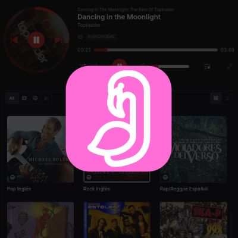
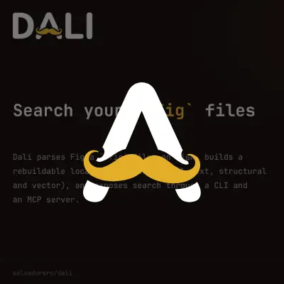
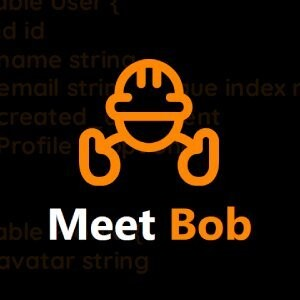
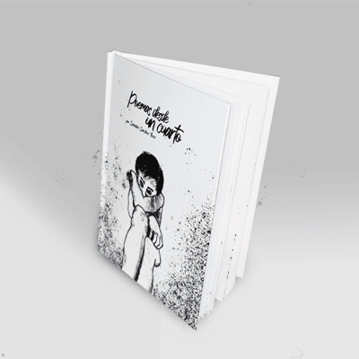

  

  
  
  
  

---

## 🏢 Organizations

- **[Jota-Music](https://github.com/Jota-Music)** — self-hosted music streaming: clients, relay and web.
- **[Bob-Object-Builder](https://github.com/Bob-Object-Builder)** — "bob", a custom SQL DSL with its transpiler, editor and tooling.

## 📌 Featured projects

<table>
  <tr>
    <td width="50%" align="center">
       
      <a href="https://github.com/Jota-Music/jota"><b>Jota</b></a> 
      <i>Self-hosted music app: Spotify, YouTube audio and rooms over your own relay.</i>
    </td>
    <td width="50%" align="center">
       
      <a href="https://github.com/salvadorsru/dali"><b>Dali</b></a> 
      <i>Local search and indexing engine for Figma .fig files, with a CLI and MCP server.</i>
    </td>
  </tr>
  <tr>
    <td width="50%" align="center">
       
      <a href="https://github.com/Bob-Object-Builder/bob"><b>Bob</b></a> 
      <i>Open source transpiler for a custom SQL DSL, written in Go.</i>
    </td>
    <td width="50%" align="center">
       
      <a href="https://github.com/salvadorsru/searchable-select"><b>searchable-select</b></a> 
      <i>Searchable dropdown web component. Native, dependency-free.</i>
    </td>
  </tr>
  <tr>
    <td width="50%" align="center">
       
      <a href="https://github.com/salvadorsru/card-deck"><b>card-deck</b></a> 
      <i>Tinder-style swipeable cards as a web component. Native, dependency-free.</i>
    </td>
    <td width="50%" align="center">
       
      <a href="https://www.salvadorsru.com/portafolio/poemas-desde-un-cuarto"><b>Poemas desde un cuarto</b></a> 
      <i>My poetry book.</i>
    </td>
  </tr>
</table>

### More

- **[simple-pot-generator-cli](https://github.com/salvadorsru/simple-pot-generator-cli)** — Go tool that generates `.pot` files for i18n.
- **[touch-command-in-rust](https://github.com/salvadorsru/touch-command-in-rust)** — the Unix `touch` command, built in Rust.

## ⚙️ Stack

  
  
  
  
  
  

---

  Poet, programmer and singer. Palma de Mallorca · 🌐 <a href="https://www.salvadorsru.com/en/">salvadorsru.com</a> · <a href="https://www.salvadorsru.com/en/portfolio"><b>/portfolio</b></a> · <a href="https://github.com/Jota-Music"><b>Jota-Music</b></a>

